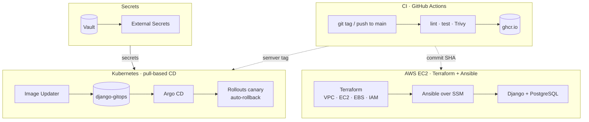

**DevOps Engineer** · Plovdiv, Bulgaria

*I build infrastructure, automate deployments, and break things in staging so they don't break in production.*

 

**AWS Certified Solutions Architect – Associate** · Oct 2026
 [Verify on Credly](https://www.credly.com/badges/dfcaf925-7ba3-45a1-bde6-13eb1d0873e5)

---

### ⭐ Featured: Django on Kubernetes, end-to-end GitOps

[**django-app**](https://github.com/filooww/django-app) · [**django-gitops**](https://github.com/filooww/django-gitops)

   

A Django + PostgreSQL service deployed two ways: on a self-built 3-node Kubernetes cluster (Kubespray, arm64) and on AWS EC2 with Terraform and Ansible.
CI only builds, scans and publishes the image; the cluster pulls new versions on its own and rolls back a bad release by itself. The badges above are live data from CI and the cluster.

- **Gitflow** with protected `main` / `develop`: merge only through a PR with a green `ci` check
- **Pull-based CD**: CI has no access to the cluster or the GitOps repo
- **Secrets in Vault**, delivered by External Secrets Operator; Git holds references only
- **Canary with automatic rollback** (Argo Rollouts): 25% of pods → smoke test → 100%; a release that is not ready in 180 s is aborted and traffic stays on the stable version
- **AWS EC2 deployment**: Terraform (VPC, security groups, EBS, IAM per server, S3 state with locking) and 7 idempotent Ansible roles; admin access through SSM, no SSH port open
- **Security checks in CI**: Trivy for the image and for Terraform, TFLint, ansible-lint; PostgreSQL connections over TLS with CA verification; daily EBS snapshots and `pg_dump` to S3
- **Helm chart** with migrations as a Job, probes, non-root read-only containers

---

### 🚀 Other projects

| Project | What it does | Stack |
|---|---|---|
| [**k8s-gitops-platform**](https://github.com/filooww/k8s-gitops-platform) | App-of-apps GitOps platform, HPA verified under k6 load, Trivy-gated CI | Kubernetes · Argo CD · Helm · Prometheus · k6 |
| [**devops-iac-aws**](https://github.com/filooww/devops-iac-aws) | Provision → configure → auto-deploy a Flask app on EC2 | Terraform · Ansible · AWS · GitHub Actions |
| [**auto-vpn**](https://github.com/filooww/auto-vpn) | Auto-connecting corporate VPN with TOTP and a watchdog | Python · Bash · OpenVPN |
| [**crm-free-agents**](https://github.com/filooww/crm-free-agents) | Real-time support-agent availability panel on top of a CRM | JavaScript · Shadow DOM |
| [**Vocab_Reader**](https://github.com/filooww/Vocab_Reader) | IELTS/SAT reading practice with AI provider failover and TTS | Node.js · Express · Redis · Fly.io |

---

### 🛠️ Stack

 

 

---

### 🌱 Now

- **Working on:** production-like load testing of the Django stack: k6 scenarios, Prometheus/Grafana, HPA, PgBouncer
- **Learning:** OpenTelemetry · Loki & Tempo · Kubernetes NetworkPolicies

---

